# Contributing

We welcome contributions to this project. By contributing, you agree to the
terms outlined below.

## Commit Message Format

HyperI projects use [Conventional Commits](https://www.conventionalcommits.org/)
and [semantic-release](https://semantic-release.gitbook.io/) for automated
versioning and changelog generation. All commits must follow this format:

```text
<type>(<scope>): <subject>

[optional body]

[optional footer(s)]
```

### Types

| Type | Description | Version Bump |
|------|-------------|--------------|
| `feat` | A new feature | Minor (0.X.0) |
| `fix` | A bug fix | Patch (0.0.X) |
| `docs` | Documentation only | None |
| `style` | Code style (formatting, semicolons, etc.) | None |
| `refactor` | Code change that neither fixes a bug nor adds a feature | None |
| `perf` | Performance improvement | Patch (0.0.X) |
| `test` | Adding or correcting tests | None |
| `build` | Changes to build system or dependencies | None |
| `ci` | Changes to CI configuration | None |
| `chore` | Other changes that don't modify src or test files | None |
| `revert` | Reverts a previous commit | Patch (0.0.X) |

### Breaking Changes

For breaking changes that require a major version bump, add `!` after the type
or include `BREAKING CHANGE:` in the footer:

```text
feat!: remove deprecated API endpoints

BREAKING CHANGE: The /v1/users endpoint has been removed. Use /v2/users instead.
```

### Examples

```text
feat(auth): add OAuth2 support for Google login

fix(api): handle null response from upstream service

docs: update installation instructions for Windows

refactor(core)!: restructure module exports

BREAKING CHANGE: Named exports are now used instead of default exports.
```

### Scope

Scope is optional but recommended. Use it to indicate the area of the codebase
affected (e.g., `api`, `auth`, `core`, `cli`, `docs`).

## Semantic Versioning

This project follows [Semantic Versioning 2.0.0](https://semver.org/):

- MAJOR (X.0.0): breaking changes that require users to modify their code
- MINOR (0.X.0): new features that are backwards-compatible
- PATCH (0.0.X): bug fixes and minor improvements

Versions are automatically determined by semantic-release based on commit
messages. Do not manually update version numbers.

## License for Contributions

All contributions to this project are licensed under the Business Source
License 1.1 (BUSL-1.1), the same license that covers the project.

Each version of the software (including your contributions) will automatically
become available under the Apache License, Version 2.0 on the third
anniversary of its release.

## How to Contribute

1. Fork the repository and create your branch from `main`
2. Make your changes following the commit message format above
3. Run the tests that cover your change
4. Submit a pull request with a clear description of what you've done

### Pull Request Checklist

- [ ] Commits follow the conventional commit format
- [ ] Tests pass (if applicable)
- [ ] Documentation is updated (if applicable)

## Run the checks locally before you push

HyperI projects gate every push through CI (lint, format, tests, secret scan,
dependency audit, build). Run the SAME checks locally first so your change lands
green instead of bouncing:

```bash
hyperi-ci check
```

`hyperi-ci` is the HyperI CI CLI (public on PyPI). If you do not have it, install
it once with `uv tool install hyperi-ci` (or `pipx install hyperi-ci`), or run it
ad hoc with `uvx hyperi-ci check`. It runs the project's full local validation --
the same suite CI runs -- and reports what to fix. Run it before every push and before opening a
pull request. It is the single best way to give your change the best chance of
surviving CI.

## CI/CD Workflow

A merge to `main` runs CI and releases nothing by itself. A release is cut when the squash-merge commit ends with a `Release: true` trailer, or when a maintainer dispatches the CI workflow with `from-head: true`. semantic-release then reads the commit messages since the last release and picks the next version, the release commit updates `CHANGELOG.md` and `VERSION`, and hyperi-ci builds and publishes the release.

## Context

### What this is

dfe-archiver is the sink at the end of the DFE pipeline. Records arrive from Kafka or the scalo Push gRPC listener, are buffered per destination, compressed, and written as rolling files to `file`, `s3`, `gs`, `az` or MinIO. It parses a record only to read its routing field, enriches nothing, routes between no topics and answers no queries. Not a library either -- all three crates set `publish = false`, and a release ships a container image on ghcr, Linux binaries on downloads.hyperi.io and a thin Helm chart. With nothing configured it starts and idles rather than crash-looping -- see [idle until configured](docs/internals.md#idle-until-configured).

### Where things live

| Path | What it holds |
|------|---------------|
| `crates/core/` | Config types, the rolling writer, the hot buffers, routing, codecs, the storage trait. It records no metrics, and its only I/O is creating the spool directory. |
| `crates/io/` | Kafka and gRPC transports, staging, and the object-store backends behind `create_backend`. Its dependencies, `object_store` and librdkafka through scalo, are the cold-build bottleneck. |
| `crates/archiver/` | The binary. `archiver.rs` the pipeline loop, `main.rs` the scalo `ServiceApp` wiring, `metrics.rs` the Prometheus surface, `contract.rs` the deployment contract, `writers.rs` the writer cache, `spool_limits.rs` the spool caps. |
| `crates/archiver/src/config/loader.rs` | `load_config` reads the file and the flat `DFE_ARCHIVER_*` names, and `validate_config` refuses structural faults. Its `init_cascade` takes effect only where nothing set scalo's cascade up first, and in the binary `run_app` already has, from `--config`. |
| `crates/archiver/src/bin/pgo_driver.rs` | The second `[[bin]]`, gated on `required-features = ["pgo-driver"]`. The gate keeps it out of the release payload: hyperi-ci skips feature-gated binaries when packaging, and verifies BOLT on the first packaged binary only. |
| `Dockerfile` | Generated from `contract.rs`. Its header names the generator and schema version. |
| `docs/architecture.md` | The parts and why it is built this way. `docs/internals.md` is each part in detail, `docs/delivery.md` the delivery guarantee. |
| `.hyperi-ci.yaml` | The PGO workload's setup command, the static-libs build, the full tier's skip list, and which gates block versus warn. `.config/nextest.toml` and `scripts/pgo-workload.sh` are what it drives. |

The archiver crate depends on both libraries, and io depends on core alone.

```mermaid
---
config:
  theme: base
  look: neo
  fontFamily: Inter, -apple-system, Segoe UI, Roboto, Helvetica, Arial, sans-serif
  flowchart:
    curve: linear
    nodeSpacing: 40
    rankSpacing: 64
    padding: 18
    wrappingWidth: 280
    htmlLabels: true
  elk:
    preset: modelOrder
  themeVariables:
    fontSize: 15px
    lineColor: "#64748B"
    primaryTextColor: "#0F172A"
    clusterBorder: "#0072B2"
    edgeLabelBackground: "#FFFFFF"
  themeCSS: >-
    p{margin:0}
    .node[data-look] rect,.node[data-look] path,.node[data-look] polygon,.node[data-look] .outer-path{filter:drop-shadow(0 1px 2px rgba(15,23,42,.10)) drop-shadow(0 6px 14px rgba(15,23,42,.10))}
    .node rect{rx:10px;ry:10px}
    .cluster rect{rx:16px;ry:16px}
    .node .label div{min-width:150px}
    .node.decision .label div{min-width:0}
    .cluster[data-look] rect{filter:none}
    .nodeLabel{line-height:1.35}
    .nodeLabel b{font-weight:600;font-size:15px;letter-spacing:-0.01em}
    .nodeLabel span{font-size:12.5px;font-weight:400;color:#334155}
    .cluster-label span.nodeLabel{display:inline-block;background:#FFFFFF;color:#0B2A3F;border:1.5px solid #0072B2;border-radius:999px;padding:2px 12px;font-size:11.5px;font-weight:700;letter-spacing:.09em;text-transform:uppercase}
    .flowchart-link{stroke-width:1.75px}
    .labelBkg{background:transparent!important}
    span.edgeLabel{display:inline-block;background:#FFFFFF!important;color:#1E293B;border:1px solid #94A3B8;border-radius:999px;padding:2px 10px;font-size:12px;font-weight:500}
    span.edgeLabel p{background:transparent!important}
    .label-icon{width:20px;height:20px;vertical-align:-4px;margin-right:6px}
    .ingest .label-icon{color:#0E8A7D}
    .xform .label-icon{color:#7B4FB0}
    .load .label-icon{color:#0072B2}
    .bus .label-icon{color:#A8517F}
    .store .label-icon{color:#00785A}
    .ui .label-icon{color:#D9480F}
    .ext .label-icon{color:#64748B}
---
flowchart LR
  accTitle: L4 Detail -- Crate dependencies
  accDescr: The archiver crate depends on both library crates, io and core. The io crate depends on core alone.
  archiver("<b>archiver</b><br/><span>the binary and the pipeline</span>")
  subgraph libs["Libraries"]
    direction LR
    io("<b>io</b><br/><span>transports and storage backends</span>")
    core("<b>core</b><br/><span>archive logic, no other crate</span>")
    io --> core
  end
  archiver --> libs
  class archiver,io,core part
  classDef ext fill:#F4F6F8,stroke:#94A3B8,stroke-width:1.5px,stroke-dasharray:5 4,color:#0F172A
  classDef ingest fill:#FFFFFF,stroke:#0E8A7D,stroke-width:3px,color:#0F172A
  classDef xform fill:#FFFFFF,stroke:#7B4FB0,stroke-width:3px,color:#0F172A
  classDef load fill:#FFFFFF,stroke:#0072B2,stroke-width:3px,color:#0F172A
  classDef bus fill:#FFFFFF,stroke:#A8517F,stroke-width:3px,color:#0F172A
  classDef store fill:#FFFFFF,stroke:#00785A,stroke-width:3px,color:#0F172A
  classDef ui fill:#FFFFFF,stroke:#D9480F,stroke-width:3px,color:#0F172A
  classDef decision fill:#FFFFFF,stroke:#9A6700,stroke-width:3px,color:#0F172A
  classDef error fill:#FFFFFF,stroke:#C2410C,stroke-width:3px,color:#0F172A
  classDef control fill:#FFFFFF,stroke:#334155,stroke-width:3px,color:#0F172A
  classDef part fill:#FFFFFF,stroke:#94A3B8,stroke-width:1.5px,color:#0F172A
  style libs fill:none,stroke:#0072B2,stroke-width:1.5px,stroke-dasharray:6 4
```



*Figure 1. L4 Detail -- Crate dependencies. An arrow points at what a crate depends on, so archiver depends on io and core alike.* Up: [L3 Components -- dfe-archiver](docs/architecture.md).

The rules between the crates, which nothing may break:

- `core` depends on no other workspace crate.
- Nothing in `core` records a metric: it counts what it did and the caller records it, which is why `ArchiveWriter::take_files_opened` exists.
- Releasing an offset and uploading a file are never `core`'s. The writer settles the offsets held on a file as it closes, or hands them to the file's pending upload, and the caller drains both with `ArchiveWriter::take_settled`, uploads, and releases through the transport.
- `io` depends on `core` and never on `archiver`.
- No crate but `archiver` has a binary or reads the deployment contract, so the Dockerfile and the chart have one source.
- No crate is publishable: all three set `publish = false`, and their version is inherited from `[workspace.package]` so the release stamp reaches every one of them.

The cold build is spent on dependencies: `object_store` with its aws, gcp and azure features, `aws-lc-sys`, which compiles C, and `rdkafka-sys` through scalo, which on Linux finds librdkafka through pkg-config (its `dynamic-linking` feature). The release build points pkg-config at a static-only prefix, so the shipped binary links librdkafka statically and needs libc, libm, libgcc_s and the dynamic loader alone at run time.

Change propagation follows the arrows: a `core` edit rebuilds all three, an `io` edit rebuilds `io` and `archiver`, and an `archiver` edit rebuilds itself alone.

### Commands that prove a change

| Command | What it covers |
|---------|----------------|
| `hyperi-ci check` | The pre-push gate. `make check` is the same. |
| `cargo nextest run` | Unit, integration and container e2e. Those are not `#[ignore]`d, so it starts Kafka, LocalStack, Azurite and fake-gcs-server via testcontainers and needs a Docker daemon. |
| `TEST_MODE=docker cargo nextest run --run-ignored all` | Adds the Kafka and `minio://` tests, against the Redpanda and S3 store `docker compose -f docker-compose.dev.yaml up -d` starts. Without `TEST_MODE=docker` the Kafka tests read `DFE_ARCHIVER_KAFKA_BROKERS` and its SASL settings from the environment or `.env`. The GCS write tests need a real bucket: `GCS_BUCKET` with `GCS_SERVICE_ACCOUNT_KEY` or `GOOGLE_APPLICATION_CREDENTIALS`. |
| `cargo deny check advisories` | Advisories and yanked crates. `quality.rust.audit` and `quality.rust.deny` are `blocking`, so a red advisory fails `hyperi-ci check` and CI too. |

Green says less than it looks, two ways:

- the `default` nextest profile sets `retries = 0` deliberately, because hyperi-ci never selects `--profile ci`. A retry there hides a real intermittent. A test pins it.
- the `push` trigger ignores `docs/**` and `**.md`, so a docs-only push runs nothing. `pull_request` has no such filter.

### What tends to bite

| Don't | Do | Why |
|-------|----|-----|
| Commit the Kafka offsets of a batch once it is written into a file. | Hold them on the file and release them when it completes. The armed consumer commits each partition up to its lowest offset not yet released. | A file is an upload in progress until it rolls, and a kill abandons it. Default routing is expression on `_org_id`, so one partition fans out to several files that complete at different times (#82). |
| Build a second `MetricsManager` in a test and assert on `render()`. | Share one manager, assert on the delta. | `set_global_recorder` succeeds once per process. Later managers keep the existing recorder and render an empty string. nextest runs each test in its own process and hides it, `cargo-llvm-cov` runs one process and does not (#84). |
| Trust `cargo update -p <crate>` to clear an advisory. | `cargo update -p <crate> --precise <fixed version>`, then build both arches. | Plain `-p` stops short of the fix when it needs a sibling such as aws-lc-rs to move too. `--precise` drags the sibling along, and `aws-lc-sys` compiles C. |
| Point `scalo` at a local path to try an unreleased change. | Keep the crates.io range. Read the local clone instead. | A path override builds against uncommitted work, so the release does not reproduce. |
| Hand-edit `Dockerfile`. | `dfe-archiver emit-dockerfile > Dockerfile`. | It is generated from the deployment contract, and a scalo release can move the generator or its schema version. |
| Give PGO a port check or a startup probe as its workload. | Drive consume, route, compress and write for 60s or more. | Shallow workloads bias the profile toward startup paths and give NEGATIVE gains. Measured on dfe-loader and dfe-receiver. |

### Where this sits

Inbound:

- hyperi-io/scalo-rs, cargo dependency. The workspace declares one `scalo` range in `[workspace.dependencies]` and all three crates inherit it, so a scalo release is a range check, a bump and a rebuild.
- hyperi-io/scalo-rs again, generator, lockstep. `Dockerfile` comes from `scalo::deployment::generate_dockerfile()` over this repo's contract, so a generator or schema-version change means regenerate and commit the diff.

Outbound -- the repo a change here breaks:

- hyperi-io/dfe-infra, image pin, lockstep. `versions.yaml` pins the image and the thin chart released here, and Argo deploys that published chart. A release here is not deployed until that pin moves. This repo commits no chart: the release assembles it from the deployment contract.

Regenerate both from dfe-infra: `python3 scripts/dfe-stack suite --consumer dfe-archiver`, and again with `--producer`.
