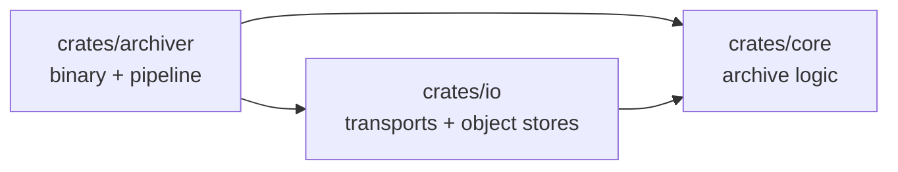

<!--
  Project:      dfe-archiver
  File:         docs/architecture.md
  Purpose:      Crate map, the one-way rules between them, and the build graph
  Language:     Markdown

  License:      BUSL-1.1
  Copyright:    (c) 2026 HYPERI PTY LIMITED
-->

# dfe-archiver architecture

Where things live and which way the dependencies point. The design itself -- the pipeline, the rolling model, the storage backends -- is [internals.md](internals.md), and the delivery guarantee [delivery.md](delivery.md).

## Codemap

| Crate | Package | What it holds |
|---|---|---|
| `crates/core` | `dfe-archiver-core` | The archive logic: config types and the flat environment names (`config.rs`), the rolling archive writer (`archive/`), the hot buffers (`buffer/`), destination routing (`routing/`), the compression codecs (`compression/`), and the storage trait with the sink probe (`storage.rs`). Its only I/O is creating the spool directory |
| `crates/io` | `dfe-archiver-io` | Everything that talks to something else: the inbound transports, Kafka (`kafka.rs`) or the Push listener (`grpc.rs`), chosen by `transport.rs`, and the staging directory and the backends behind `create_backend` (`storage.rs`): file, S3, GCS, Azure Blob and MinIO |
| `crates/archiver` | `dfe-archiver` | The binary and the pipeline that joins the other two. `archiver.rs` is the loop (receive, route, buffer, write, hand closed object-store files to background upload tasks, and release once a file is durable), `main.rs` the scalo `ServiceApp` wiring, CLI and config reloader, `config/loader.rs` the file loading and `validate_config`, `metrics.rs` the Prometheus surface, and `contract.rs` the deployment contract the checked-in `Dockerfile` and the Helm chart are generated from |

## Negative invariants

- `core` depends on no other workspace crate.
- Nothing in `core` records a metric: it counts what it did and the caller records it, which is why `ArchiveWriter::take_files_opened` exists.
- Releasing an offset and uploading a file are never `core`'s. The writer settles the offsets held on a file as it closes, or hands them to the file's pending upload, and the caller drains both with `ArchiveWriter::take_settled`, uploads, and releases through the transport.
- `io` depends on `core` only, never on `archiver`.
- `archiver` is the only crate with a binary and the only reader of the
  deployment contract, so the Dockerfile and the chart have one source.
- No crate is publishable: all three set `publish = false`, and their version
  is inherited from `[workspace.package]` so the release stamp reaches every
  one of them.

## Build graph

The cold build is spent on dependencies: `object_store` with its aws, gcp and azure features, `aws-lc-sys`, which compiles C, and `rdkafka-sys` through scalo, which on Linux finds librdkafka through pkg-config (its `dynamic-linking` feature). The release build points pkg-config at a static-only prefix, so the shipped binary carries librdkafka statically and needs only libc, libm, libgcc_s and the dynamic loader at run time.

Change propagation follows the arrows: a `core` edit rebuilds all three, an `io`
edit rebuilds `io` and `archiver`, and an `archiver` edit rebuilds only itself.
