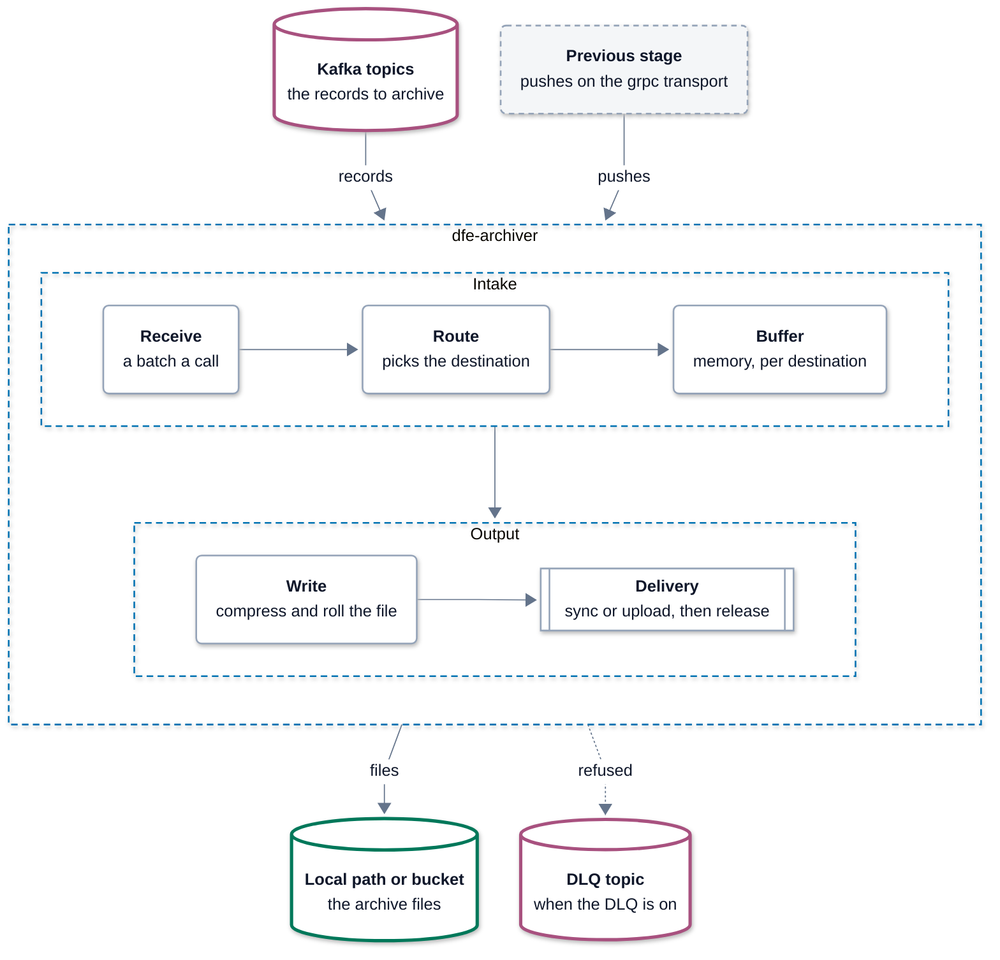

<!--
  Project:      dfe-archiver
  File:         docs/architecture.md
  Purpose:      The archiver's parts, how a record flows through them, and why
  Language:     Markdown

  License:      BUSL-1.1
  Copyright:    (c) 2026 HYPERI PTY LIMITED
-->

# dfe-archiver architecture

dfe-archiver is the sink at the end of the DFE pipeline: it writes every record it is given into compressed, rolling files on a local path or in a bucket. It keeps each record exactly as it arrived, so a deployment can restore or replay it.

*Figure 1. L3 Components -- dfe-archiver. The grey dashed box is external and the dotted arrow takes refused records to the DLQ when it is on.* Up: top of dfe-archiver. Down: [L4 Detail -- Delivery](delivery.md).

## How data flows

1. Receive takes up to `kafka.batch_size` records a call, 10,000 by default, from a Kafka consumer group or the scalo Push listener. Nothing after it knows which transport delivered them.
2. Route picks each record's destination: its topic, then the value of each routing field, `_org_id` by default.
3. Buffer holds records in memory per destination and flushes by size, count or age.
4. Write compresses each flush into that destination's open file. A file rolls at 1 GiB compressed or at the roll interval.
5. Delivery syncs a closed local file, or uploads a staged one, and only then releases its records. On `kafka` that release is the offset commit.

A record refused for good, by the store, the codec or the nesting check, goes to the DLQ topic when the DLQ is on.

## Components

| Part | Role | Page |
|---|---|---|
| Receive | The Kafka consumer or the Push listener, picked by `transport` | [Two transports, one pipeline](internals.md#two-transports-one-pipeline) |
| Route | Topic, then routing fields, each segment encoded so it never names another directory | [Routing](internals.md#routing) |
| Buffer | At most 64 hot buffers, a quarter of the memory limit between them | [Buffers and writers](internals.md#buffers-and-writers) |
| Write | One open file per destination, compressed frames, rolled by size or age | [Files roll by compressed size or age](internals.md#files-roll-by-compressed-size-or-age) |
| Delivery | Sync or upload, then release. The DLQ, shutdown and disk limits | [delivery.md](delivery.md) |

## External dependencies

| Dependency | Needed for | Swappable |
|---|---|---|
| Kafka | The `kafka` transport and the DLQ | Any Kafka, or none on `grpc` |
| A previous stage | The `grpc` transport, pushing to port 6000 | dfe-receiver or any scalo Push sender |
| A local path or object store | The archive files | `file://`, S3, MinIO, GCS or Azure Blob |
| A spool volume | Staged uploads and quarantine | Any writable volume. A size limit sets the caps |

## Deployment variants

The image is the same everywhere. What changes is the transport and the destination.

- On Kubernetes the thin Helm chart deploys it, generated from the deployment contract, and dfe-infra pins the chart and image in `versions.yaml`. The spool is an `emptyDir` with a size limit, which sets the staging caps.
- On Docker, or a bare host, the spool caps default to 8, 1 and 1 GiB.
- `transport: kafka` is the default and gives at-least-once delivery. `transport: grpc` lets a deployment with no broker archive, at-most-once, with no DLQ.
- With no `archive.destination` it starts, reports Ready and idles until a config reload names one.

## Design considerations

| Aspect | How it is handled |
|---|---|
| Security | Every path segment is encoded, so a field value never names another directory, and every backend rejects an absolute path or a `..` segment. Store credentials come from each SDK's own chain or from a Secret as environment variables |
| Reliability | On `kafka` no record is lost while the topic holds it. A kill or store outage costs duplicates or lag. A failed upload keeps its file and offsets and retries with backoff |
| Operations | `/livez`, `/readyz`, `/metrics` and `/scaling/pressure` on port 9090. A config change or SIGHUP reloads `kafka.batch_size` and starts an idle archiver, and any other change logs that it needs a restart |
| Performance | Upload memory stays near 64 MiB whatever the file size. Held offsets cost about 32 bytes each, which is why the roll interval drops to 300 s when they are held |

## Why it's built this way

| Decision | Reason |
|---|---|
| Release on a durable file, not on write | A file is an upload in progress until it rolls, and a kill abandons it. Committing at write would lose what the open file held |
| Stage, then upload whole | A multipart upload read from the staged copy signs its requests afresh on every attempt, however long the store was down, and the loop never waits on the store |
| Pressure pauses intake | Held records and staged bytes feed the self-regulation latch, so a store outage turns into lag rather than memory or disk growth |
| A unique writer id in every key | A staged file is never checked against the store. Without it two replicas could pick one key and the later upload would replace the earlier object |
| `_land` over `_load` on discovery | The archive keeps the record as it arrived. dfe-loader keeps `_load` |

## Diagram map

- Figure 1. L3 Components -- dfe-archiver (this page)
  - [L4 Detail -- Delivery](delivery.md)
- [L4 Detail -- Crate dependencies](../CONTRIBUTING.md#where-things-live)
- [L4 Detail -- CI pipeline](design.md)

## What's next

- [How the archiver works](internals.md): every part in detail
- [Archiving](archiving.md): what a file holds, where it goes and how to restore
- [Configuration reference](configuration.md) and [Metrics reference](metrics.md)
- [CONTRIBUTING.md Context](../CONTRIBUTING.md#context): the crate map and the rules between the crates
