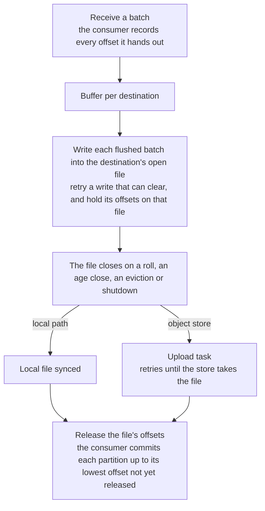

<!--
  Project:      dfe-archiver
  File:         docs/delivery.md
  Purpose:      When a record is released, what can drop one, and how disk and memory stay bounded
  Language:     Markdown

  License:      BUSL-1.1
  Copyright:    (c) 2026 HYPERI PTY LIMITED
-->

# Delivery

On `kafka` with `kafka.acknowledgements.enabled` (the default) no record is lost while the topic still holds it. A kill, a failed upload, a failing local disk or a store outage costs duplicates or consumer lag. Kafka's retention deletes records whether or not the archiver has read them, and a commit that falls below the log start resets to the earliest record left, so size retention for the longest outage you will ride out. Only a record refused for good, by the store, the codec or the nesting check, can be dropped, when no DLQ can take it, and it is counted. On `grpc` the archive copy is at-most-once, because the listener answers each push once its records are queued ([internals.md](internals.md#two-transports-one-pipeline)). How the pipeline gets a record into a file is [internals.md](internals.md).

## A record is released when its file is durable

Default routing on `_org_id` sends one partition's records to several files that complete at different times, so a partition commits only up to its lowest offset not yet released. `kafka.acknowledgements.enabled: false` commits each batch at receipt instead, and a kill then loses what the buffers and open files held.

An object-store file is written to `<buffer.spool_dir>/uploads` and uploaded whole once it closes, in a background task the loop collects each cycle, so the loop never waits on the store. A failed upload keeps the staged file and its held offsets and tries again. The waits double from 0.5 s to a 60 s ceiling, each drawn from the upper half of its step so uploads that failed together spread out. Every attempt is a fresh multipart upload from the staged copy, so it signs its requests afresh however long the store has been down. A failed attempt aborts its upload.

A staged copy that cannot be read back, because it is missing, unreadable by permission or shorter than the bytes staged, moves to `<buffer.spool_dir>/uploads/quarantine` and its offsets are released `Errored`. Any other read error, EIO included, is retried.

### Holding costs memory

A held record costs about 32 bytes until its file is durable. At 10,000 records a second that is 96 MB over a 300 s roll and 1.15 GB over an hour, so while offsets are held an unset `archive.roll_interval_secs` is 300 s rather than 3600 s. A configured value always wins, and one above 900 logs a startup warning with the cost.

While uploads fail, held records and staged bytes grow, so both are pressure sources on the self-regulation latch. Held records read against a quarter of the memory limit at 32 bytes each, and staged bytes against `buffer.staged_bytes_cap`. Past the latch's `pause_above` (0.8 by default) the consumer pauses its partitions and the Push listener sheds pushes with `Unavailable`, so a store outage turns into lag rather than memory or disk growth. With self-regulation off nothing pauses, and the archiver logs that at startup.

## Refused for good goes to the DLQ

Only a refusal of the object itself is permanent. That is an invalid path, a key past 1024 bytes, checked before any record is staged, a name the local filesystem cannot hold, or an `EntityTooLarge`, `KeyTooLongError` or `InvalidObjectName` answer. Anything else, credentials and a missing bucket included, is retried, because retrying costs lag where dropping costs records.

A file the store refuses is read back a block at a time, each block one flush decompressed on its own, and its records go to the DLQ one entry per line with the routed destination. A payload holding a newline of its own spans lines, so when a file holds more lines than records each block goes whole, as one entry saying so, and no record is split across entries. The file's offsets are released `Rejected` once the DLQ confirms them.

A batch the codec refuses as it is written goes to the DLQ through scalo's confirming write, one entry per record, and only a confirmed write releases a record's offset `Rejected`. Before any write, `Dlq::refusal` screens each entry. Only the Kafka backend has a ceiling, the producer's `message.max.bytes`, against the entry as written: a JSON object goes in as itself and anything else as text or base64. A file backend beside Kafka, as under the default `dlq.mode: cascade`, takes what Kafka refuses, so only a Kafka-only DLQ refuses an entry. A record no backend can hold is released `Dropped`, counted and logged, and the rest still go. A broker or topic ceiling below the producer's is not seen there, and fails the write instead.

With the DLQ off, as it always is on `grpc`, a refused batch or file is released `Dropped` with its reason. A failed DLQ write is released `Errored`, because it can clear. Inbound-filter dead letters are screened the same way, and one no backend can hold is dropped, because the filter routed it out of the archive by policy.

Every dropped record is counted in `messages_dropped_total` under one `reason`: `refused` (the store or the codec, with the DLQ off), `dlq_too_large`, `too_deep` (nested past the parse depth, with the DLQ off) or `unreplayable`.

## A local write that fails is held, never dropped

A local write that fails in a way that can clear, a full or failing disk or staging that cannot be created, is never dead-lettered. The failed append is cut back to the file's last whole block, and the batch and its offsets are held while the write is retried, the waits doubling from 0.1 s to a 5 s ceiling. The loop receives nothing until the write lands, so nothing later is read or committed past it, and a disk that stays broken shows as lag and one warning.

While it waits, a file the write rolled uploads at once, and another destination's file closes at its roll interval and uploads, because a full staging disk frees only as the store takes files. Once shutdown begins, a write still failing gets 10 s more, then its batch is released `Errored`. A file that cannot be cut back, or cannot complete because its sync or staging failed, is given up, and its offsets are `Errored` too.

Nothing reads an `Errored` span again short of a restart or rebalance, and scalo's consumer has no seek back to the commit floor, so the loop ends with `Error::Withheld`. The process drains, exits non-zero, and the restart reads again from the committed offset. A source that cannot deliver the records again, `grpc` or `kafka` with acknowledgements off, has already let them go, so they are counted in `messages_dropped_total{reason="unreplayable"}` instead.

## Failures and what they cost

| Failure | Outcome | Records |
|---|---|---|
| Kill before the file is durable | The restart reads every record the file held again, and removes the staged files it left | Duplicates, up to one roll interval plus pending uploads |
| Upload fails | File and offsets kept, upload aborted and retried, intake paused near the caps | Delayed, never lost |
| Staged copy cannot be read back | File quarantined, offsets released `Errored`, the process exits and restarts | Duplicates |
| Store refuses the object for good, DLQ confirms | Records read back into the DLQ, offsets released | In the DLQ |
| Store refuses the object for good, DLQ off | Offsets released `Dropped`, counted, reason logged | Dropped |
| Local write fails in a way that can clear | Append cut back, batch and offsets held, write retried, intake held | Delayed, never lost |
| Local write still failing 10 s into shutdown | Offsets released `Errored`, the restart reads them again | Duplicates |
| Local file cannot complete or be cut back | Offsets released `Errored`, the process exits and restarts | Duplicates |
| Codec refuses a batch, DLQ confirms | Offsets released `Rejected` | In the DLQ |
| Refused for good, no DLQ backend can hold one record | That record's offset released `Dropped`, counted, reason logged, the rest to the DLQ | That record dropped |
| Refused for good, DLQ write fails | Offsets released `Errored`, the process exits and restarts | Duplicates |

## Shutdown and restart

The run loop stops first. The drain then closes the source, so the Push listener stops answering and the Kafka consumer stops fetching but can still commit, and receives until the source reports it is empty, so every push already answered is written. A source that returns nothing for 5 s without reporting empty ends the drain. Buffers flush into their files, evicted writers finish closing, every open file completes, and the uploads get 20 s. A file still uploading then keeps its offsets unreleased and its staged copy on disk.

A completed staged file carries a manifest beside it, `<name>.part.json`, with its object path and the length of each block. At startup the staging directory is settled before anything new is staged:

- On `kafka` with acknowledgements on, every staged file is removed, because its records are read again from the committed offset.
- On `grpc`, or with acknowledgements off, nothing delivers those records again. A file whose manifest matches its size is uploaded. One never completed, or whose manifest cannot be read, moves to `<buffer.spool_dir>/uploads/quarantine` for an operator.

Quarantine holds at most `buffer.quarantine_bytes_cap`, and a file past it is removed. Each outcome is counted in `staged_files_recovered_total`, `staged_files_quarantined_total{reason}` and `staged_files_removed_total{reason}`.

## Disk stays under the spool volume's limit

Only archive files sit on local disk: the open file of a local destination, and under `<buffer.spool_dir>/uploads` the staged copy of each object-store file until the store takes it, with the quarantine beside them.

1. At startup the archiver refuses to start with less than `buffer.min_free_spool_bytes` free on the staging volume, read once staging is settled. When it kept complete files to upload it starts anyway and warns, because only a running archiver uploads them.
2. Staged bytes pause intake at the latch's `pause_above` share of `buffer.staged_bytes_cap`, which sits under the volume's `emptyDir` limit, past which kubelet evicts the pod.
3. Quarantine holds at most `buffer.quarantine_bytes_cap`, and a file past it is removed and counted.
4. A local write that finds the disk full is held and retried, never dropped, while uploads free the staging disk.

`staged_bytes` and `uploads_pending` show what is waiting for the store ([metrics.md](metrics.md)).
