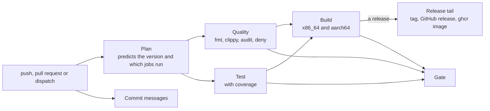

<!--
  Project:      dfe-archiver
  File:         docs/design.md
  Purpose:      Build, release and design decisions for contributors
  Language:     Markdown

  License:      BUSL-1.1
  Copyright:    (c) 2026 HYPERI PTY LIMITED
-->

# DFE Archiver build and design notes

How the archiver is built and released, and the design decisions behind it. The operator-facing design is [internals.md](internals.md).

## Building & Artifacts

### Local Build

```bash
# Debug build
cargo build

# Release build (production, with jemalloc)
cargo build --features default,jemalloc --release
```

**Output location:**

| Build Type | Path |
|---|---|
| Debug (native) | `target/debug/dfe-archiver` |
| Release (native) | `target/release/dfe-archiver` |
| Cross-compile (x86_64) | `target/x86_64-unknown-linux-gnu/release/dfe-archiver` |
| Cross-compile (aarch64) | `target/aarch64-unknown-linux-gnu/release/dfe-archiver` |

### CI/CD Pipeline

`.github/workflows/ci.yml` calls hyperi-ci's reusable `rust-ci.yml` workflow. Configuration is in `.hyperi-ci.yaml`.

**Pipeline stages:**



### Build Targets

| Target | Architecture | Notes |
|---|---|---|
| `x86_64-unknown-linux-gnu` | AMD64 | Primary production target |
| `aarch64-unknown-linux-gnu` | ARM64 | AWS Graviton, Apple Silicon Linux |

Cross-compilation uses the CI cross-compilation toolchain (not vendored system
libraries). `rdkafka` uses its `dynamic-linking` feature, which finds librdkafka
through pkg-config. The release build points pkg-config at a static-only prefix
(scalo-rs `docs/deployment/native-deps.md`), so the shipped binary carries
librdkafka statically.

### Artifact Destinations

No crate is published: all three set `publish = false`.

| Artefact | Destination |
|---|---|
| Container image | `ghcr.io/hyperi-io/dfe-archiver` |
| Binaries | hyperi-ci's `release.destinations.binaries`, Cloudflare R2 (`downloads.hyperi.io`) by default |
| Release notes | `https://github.com/hyperi-io/dfe-archiver/releases/`, with no binaries attached |

**Binary naming convention:**

```text
dfe-archiver-{version}-linux-amd64     # x86_64
dfe-archiver-{version}-linux-arm64     # aarch64
```

**Checksums:** `SHA256SUMS` file published alongside binaries.

### Release Profile

```toml
[profile.release]
lto = "thin"          # Link-time optimization
codegen-units = 1     # Single codegen unit for better optimization
strip = true          # Remove debug symbols
panic = "abort"       # Smaller binary, no unwinding overhead
opt-level = 3         # Maximum optimization
```

---

## Key Design Decisions

### 1. Use scalo for Core Infrastructure

**Decision**: Use scalo for config, logging, metrics, and Kafka transport.

**Rationale**: Consistency with other HyperI projects, proven patterns, reduced boilerplate.

**Alternatives**: Direct rdkafka usage, custom config system.

### 2. Compression Codec Selection

**Decision**: Default to zstd level 3, support lz4/snappy/gzip.

**Rationale**: zstd offers the best compression ratio at acceptable speed. lz4 is for speed-critical work and gzip for compatibility.

**Alternatives**: brotli (too slow), lzma (too slow).

### 3. Rolling by Final Compressed Size

**Decision**: Roll based on actual compressed file size (1GB default), not inbound data.

**Rationale**: 1GB files optimal for cloud storage. Inbound data size is unpredictable for final file size.

**Alternatives**: Inbound data size, record count only.

### 4. Tiered Buffering

**Decision**: Hot buffers in memory, under a ceiling per destination and a cap on all of them, then the archive writers. Nothing spills to disk ahead of the writers.

**Rationale**: Handles 10K+ destinations without exhausting memory or file handles.

**Alternatives**: Single large buffer (memory issues), per-destination files (handle exhaustion).

### 5. At-Least-Once via Token Tracking

**Decision**: Track a Kafka offset per message, hold it on the archive file its record is written into, and release it when that file completes.

**Rationale**: A record is durable only in a completed file. On Kafka with acknowledgements on, a kill therefore loses nothing that reached a file, and duplicates after a restart are acceptable for the archive use case. They run to a roll interval of records, longer while a completed file's upload is still pending, because its offsets are held until the store confirms it.

The guarantee has two drop cases. A record refused for good (by the store, the codec or the router) is released `Dropped` when the DLQ is off or no DLQ backend can hold it. On a source that cannot deliver again (`grpc`, or acknowledgements off), records written nowhere are released `Dropped` too.

**Alternatives**: Exactly-once (complex, requires transactional writes).
