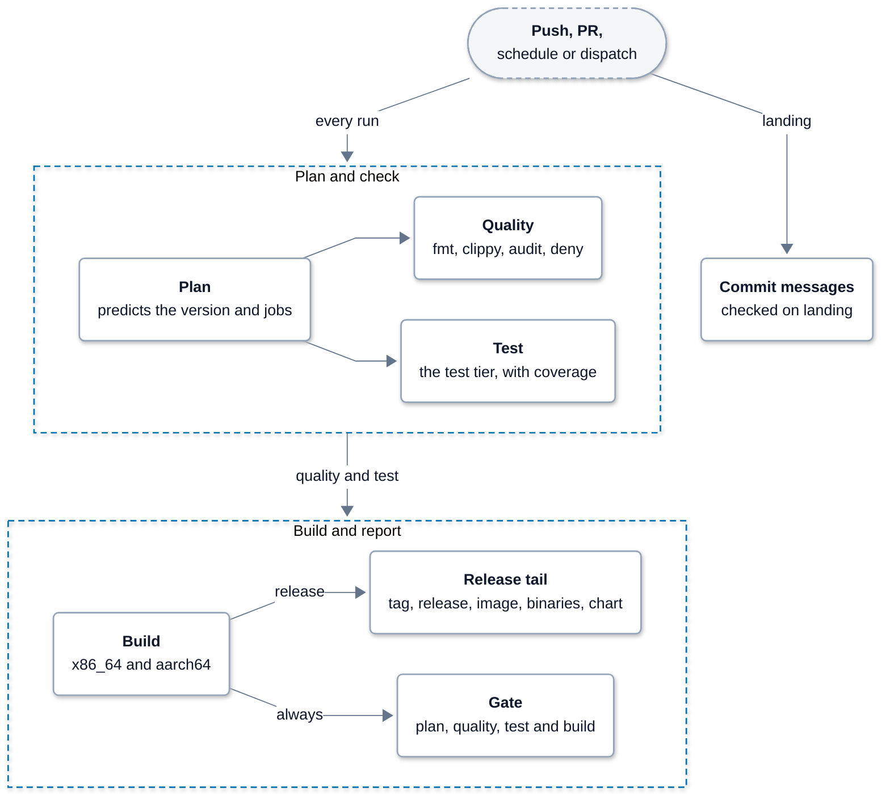

<!--
  Project:      dfe-archiver
  File:         docs/design.md
  Purpose:      Build, release and design decisions for contributors
  Language:     Markdown

  License:      BUSL-1.1
  Copyright:    (c) 2026 HYPERI PTY LIMITED
-->

# DFE Archiver build and design notes

How the archiver is built and released, and the design decisions behind it. The operator-facing design is [internals.md](internals.md).

The build needs the tools in the README's [quick start](../README.md#quick-start). `cargo build` writes a debug binary to `target/debug/dfe-archiver`, and `cargo build --release --features jemalloc` a release one, with the allocator CI uses, to `target/release/dfe-archiver`. jemalloc is off by default, so a plain `cargo build` uses the system allocator.

CI builds each target on a runner of the same architecture, never cross-compiling, with `--target`, so its binaries land under `target/x86_64-unknown-linux-gnu/release/` and `target/aarch64-unknown-linux-gnu/release/`. `rdkafka` takes its `dynamic-linking` feature, which finds librdkafka through pkg-config, and the release build points pkg-config at a static-only prefix (scalo-rs `docs/deployment/native-deps.md`), so the shipped binary links librdkafka statically.

```toml
[profile.release]
lto = "thin"
codegen-units = 1
strip = true
panic = "abort"
opt-level = 3
```

That is the committed profile. hyperi-ci switches LTO to `fat` on the beta and release channels, and a full release adds PGO, driven by `scripts/pgo-workload.sh`, and BOLT.

`.github/workflows/ci.yml` calls hyperi-ci's reusable `rust-ci.yml` workflow, configured by `.hyperi-ci.yaml`.

Quality and test both gate the build, and the build feeds the release tail and the gate.



*Figure 1. L4 Detail -- CI pipeline. The gate checks plan, quality, test and build, and the commit check and release tail report separately.* Up: [dfe-archiver documentation](README.md).

The commit check runs on landing: a push to main, a pull request or a merge queue group.

| Job | What it does |
|---|---|
| Plan | Predicts the version and which jobs run |
| Quality | fmt, clippy, audit and deny |
| Test | The test tier, with coverage |
| Build | x86_64 and aarch64, each on a runner of that arch, with PGO then BOLT on a full release |
| Release tail | The tag, the GitHub release, the ghcr image, the binaries to R2 and the Helm chart |

A schedule run tests and publishes nothing. A release needs a `Release: true` trailer on the commit pushed to `main`, or a dispatch, as [CONTRIBUTING.md](../CONTRIBUTING.md#cicd-workflow) says. No crate is published, because all three set `publish = false`.

| Artefact | Where it goes |
|---|---|
| Container image | `ghcr.io/hyperi-io/dfe-archiver`, for `linux/amd64` and `linux/arm64` |
| Binaries | hyperi-ci's `release.destinations.binaries`, Cloudflare R2 (`downloads.hyperi.io`) by default, under `dfe-archiver/v<version>/` and `dfe-archiver/latest/` |
| Helm chart | the thin chart hyperi-ci assembles from the deployment contract on the scalo-service library, pushed to `release.helm.registry`, `oci://ghcr.io/hyperi-io/charts` by default |
| Release notes | `https://github.com/hyperi-io/dfe-archiver/releases/`, with no binaries attached |

The binaries are `dfe-archiver-linux-amd64` and `dfe-archiver-linux-arm64`. Each has a `<binary>.sha256` beside it, in the format `sha256sum -c` reads.

The design decisions behind it:

| Decision | Why | Rejected |
|---|---|---|
| scalo for config, logging, metrics, the transports, the DLQ and scaling | The same patterns as the other DFE apps, and less code here | Direct rdkafka, a bespoke config system |
| zstd at level 3 by default, with LZ4, Snappy and gzip | zstd gives the best ratio at an acceptable speed, LZ4 suits speed-critical work and gzip compatibility | brotli and lzma, both too slow |
| Roll on compressed file size, 1 GiB by default | Inbound size does not predict the size a file reaches in the store | Inbound size, record count |
| Hot buffers in memory under a ceiling per destination and a cap on all of them, then the writers, with nothing spilled to disk ahead of them | Memory and open files stay bounded however many destinations routing produces | One large shared buffer, an unbounded file per destination |
| Hold each Kafka offset on the file its record is in, and release it when the file is durable | At-least-once with no transactional writes, at the cost of duplicates after a restart ([delivery.md](delivery.md)) | Exactly-once, which needs transactional writes |
