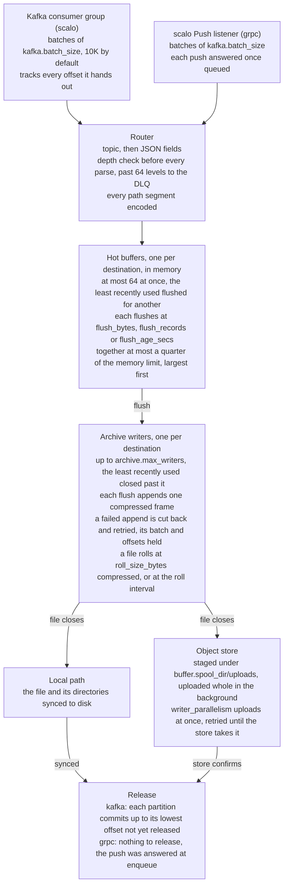

<!--
  Project:      dfe-archiver
  File:         docs/internals.md
  Purpose:      How the pipeline moves a record from the transport into a file
  Language:     Markdown

  License:      BUSL-1.1
  Copyright:    (c) 2026 HYPERI PTY LIMITED
-->

# How the archiver works

A record arrives on Kafka or the scalo Push listener, is routed to a destination, buffered in memory, compressed into that destination's open file, and released once the file is durable. When a record is released and what can drop one is [delivery.md](delivery.md). Every key and variable is in [configuration.md](configuration.md), every metric in [metrics.md](metrics.md), and the crates behind it in [architecture.md](architecture.md).

## The pipeline



## Two transports, one pipeline

`transport` picks how records arrive, and nothing after the receive knows which one delivered them.

| `transport` | How records arrive | Release point |
|---|---|---|
| `kafka` | a consumer group over the topics | the offset commit, once the archive file holding the record is complete |
| `grpc` | the scalo Push listener, from the previous stage | none: the push was answered when its records were queued |

On `kafka` an empty `kafka.topics` turns on discovery, re-read every `kafka.topic_refresh_secs`, so a source added later is archived without a restart. It takes every topic `kafka.topic_exclude` keeps, by default all but Kafka's internal and `_dlq` topics, narrowed by `kafka.topic_include` when set. Where a source has both `<name>_land` and `<name>_load`, it keeps `_land`, the record as it arrived, where dfe-loader keeps `_load`.

`grpc` lets a deployment with no broker still archive. The previous stage pushes each record to the listener on `grpc.listen`, by default `0.0.0.0:6000`, the contract's push port. The listener answers a push once its records are queued, because a record is released only when its file completes, long after any sender's deadline. So the archive copy on `grpc` is at-most-once, and `pipeline_delivery_guarantee` reports `best_effort` with reason `sink_cannot_confirm`, or `acks_disabled` under `grpc.acknowledgements.enabled: false`. There is no broker to dead-letter to, so the DLQ is off.

A DFE deployment feeds the archiver from a broker or from the previous stage, so the binary compiles in scalo's `transport-kafka` and `transport-grpc` and no other transport, and `validate_config` refuses any other `transport` at startup.

### Idle until configured

An archiver with no `archive.destination` starts anyway. It stays Ready, serves `/livez`, `/readyz` and `/metrics`, opens no broker connection, binds no listener, logs the reason once and holds `pipeline_idle` at 1. A change to the `--config` file, or a SIGHUP, reloads the config, and one that names a destination starts the pipeline with no restart. The gate is scalo's (`scalo::lifecycle`), and the predicate is `Config::idle_reason`.

Structural faults still refuse at startup: an unknown transport, `grpc` with no listen address, `kafka` with no brokers, and a codec or routing mode that does not exist.

## Buffers and writers

Each destination gets a hot buffer in memory and an archive writer with one open file. Nothing spills to disk ahead of the writers.

- At most 64 destinations buffer at once. A record for another first flushes the buffer that has gone longest without one, counted in `hot_buffer_evictions_total`.
- A buffer flushes at `buffer.flush_bytes` plus one record, at `buffer.flush_records`, or once `buffer.flush_age_secs` has passed since its last flush, checked on each record and on a timer.
- All buffers together hold at most a quarter of the memory guard's limit. Past it the largest flush first, so `flush_bytes` is a ceiling per destination, never multiplied by the destination count.
- A buffer allocates nothing until a record arrives and hands its memory to the batch it flushes. The cap counts bytes buffered, and a growing buffer's allocation can run to twice that.
- Past `archive.max_writers` writers, the one that has gone longest without a write closes in the background and its file completes as on a roll (`writer_evictions_total`). It keeps its slot while it closes, so a write for a new destination waits.
- A writer hands its data to the compressor at each flush, so an idle writer holds no buffer.

| Key | Default | What it sets |
|---|---|---|
| `buffer.flush_bytes` | 1 MiB | Size at which a destination's buffer flushes into its file |
| `buffer.flush_records` | 100,000 | Record count at which a buffer flushes, whatever its size |
| `buffer.flush_age_secs` | 60 | Seconds since its last flush at which a buffer flushes |
| `buffer.writer_parallelism` | 2 | Object-store uploads at once, each holding four parts of `archive.multipart_chunk_size` |
| `buffer.spool_dir` | `/var/spool/dfe/archiver` | Parent of the staging directory, `uploads/` |
| `buffer.staged_bytes_cap` | 8/9 of the spool budget | Staged bytes past which intake pauses. Must be above 0 |
| `buffer.min_free_spool_bytes` | 1/9 of the spool budget | Free bytes the spool volume needs at startup when staging holds nothing to upload |
| `buffer.quarantine_bytes_cap` | 1/9 of the spool budget | Bytes the quarantine directory may hold |
| `archive.max_writers` | 1024 | Archive writers open at once, closing ones included |

The 64-buffer count and the quarter share are fixed, not configured.

The spool budget is 90% of the size limit declared for the spool volume, which the chart passes in `SCALO_WRITABLE_PATH_LIMITS` for each `emptyDir` with a `sizeLimit`. So the three caps are 80%, 10% and 10% of that limit, 8, 1 and 1 GiB on the contract's 10Gi volume, and a larger volume raises all three. With no limit declared, as in docker or on a bare host, they are 8, 1 and 1 GiB. A key that is set wins.

## Files roll by compressed size or age

A file closes when its compressed size reaches `archive.roll_size_bytes` (1 GiB) or its age reaches the roll interval, and `archive_roll_total{trigger}` counts each by `size` or `age`. Size counts compressed bytes in the file, never inbound or buffered bytes. A timer closes an aged file even when nothing arrives, and opens no empty successor.

The roll interval is `archive.roll_interval_secs`. Unset, it is 300 s while offsets are held (`kafka` with acknowledgements on) or on `grpc`, otherwise 3600 s, because held offsets cost memory ([delivery.md](delivery.md#holding-costs-memory)).

A file's key is the routed destination, then `archive.path_template` expanded, then `-<seq>-<writer id>`, then `.jsonl` and the codec's extension:

```text
events/acme/2026/10/29/03-0001-9c41d2e07b3a5f68.jsonl.zst
```

```yaml
archive:
  path_template: "{year}/{month}/{day}/{hour}"
```

The template carries no topic placeholder, because the routed destination already starts with the topic. It takes `{year}`, `{month}`, `{day}`, `{hour}` and `{minute}` in UTC, `{timestamp}` as Unix seconds and `{seq}`, the file's four-digit sequence number in that window. Validation refuses any other `{...}` token rather than let it reach the key as literal braces.

The writer id is 16 hex digits no other writer shares. A staged file is never checked against the store, so without it two replicas, or an evicted writer closing beside its replacement, could pick one key and the later upload would replace the earlier object.

## Routing

`routing.mode: expression`, the default, files each record under its topic and then the value of each field in `routing.expression_fields`, in dot notation for a nested field. `routing.mode: topic` files it under the topic alone and parses nothing. Unset, the fields are `_org_id` on `kafka`, where each source has its own topic, and `_source` then `_org_id` on `grpc`.

```yaml
routing:
  mode: expression
  expression_fields:
    - _org_id
    - event_type
```

With those fields, `{"_org_id": "acme", "event_type": "login", "data": {}}` on topic `events` lands under `events/acme/login`. A field `tags.category` reads `{"tags": {"category": "security"}}` and the record lands under `events/security`.

On `grpc` the topic is the push's routing key, and dfe-receiver sends none, so there is no topic folder. With the default fields `{"_source": "cisco_ios.log", "_org_id": "acme"}` lands under `cisco_ios.log/acme`. Under `mode: topic` a record with no key lands under `routing.default_segment`.

A field the record does not carry, or carries null or blank, takes `routing.default_segment`, which is `default`, the id dfe-receiver gives the default org. Each is counted in `routing_fallback_total{field}` and warned at most once a minute. A record that is not JSON goes under its topic, counted in `routing_errors_total`.

Every segment, the topic and each value, is encoded before it becomes part of a path, so a value never names another directory. Letters, digits, `-`, `_` and `.` pass through. Every other byte is written `=XX` in upper-case hex, `=` itself included, so `a/b` becomes `a=2Fb` and two values never share a name. The empty value is written `=`, and `.` and `..` become `=2E` and `=2E=2E`. Every backend refuses an absolute path, or one with a `.` or `..` segment, for good.

Expression routing checks a record's nesting before it parses it, because `sonic-rs` recurses once per level with no limit. A record nested past scalo's maximum parse depth of 64 is never parsed. It goes to the DLQ as it arrived, under its topic with the reason `payload nesting exceeds the maximum parse depth of 64`, and its offset is released `Rejected`. With the DLQ off, as on `grpc`, or when no DLQ backend can hold it, the record is dropped and counted in `messages_dropped_total{reason}`.

## Compression

Each flush appends one complete frame, framed stream or gzip member, so a file of many flushes is one concatenated stream the codec's own tools read whole. Dead-lettering a refused file reads it back the same way, a flush at a time.

| `compression.codec` | Extension | Format |
|---|---|---|
| `zstd` (default) | `.zst` | zstd frames |
| `lz4` | `.lz4` | LZ4 frames, as the `lz4` tool reads them |
| `snappy` | `.sz` | the Snappy framing format (`application/x-snappy-framed`) |
| `gzip` | `.gz` | gzip members |
| `none` | none | the lines as written |

`compression.level` (3) sets the zstd level, clamped to 1 through 22, and the gzip level, capped at 9. LZ4 and Snappy take no level. `compression.enabled: false` writes uncompressed files whatever `codec` says.

## Storage backends

`file:///path`, or a bare path, writes under that directory, which should be a mounted volume, never the root filesystem. Closing a file syncs it, and every directory above it up to the destination, before its offsets are released, so a node crash after the commit cannot lose it. A directory the archiver creates has its entry synced into the nearest parent that already existed.

`s3://`, `minio://`, `gs://` (or `gcs://`) and `az://` (or `azure://`) go through the `object_store` crate. A file is staged under `buffer.spool_dir/uploads` and uploaded whole once it closes, as one multipart upload read from the staged copy. Parts are `archive.multipart_chunk_size`, 8 MiB by default and at least 5 MiB, S3's smallest part. Four are in flight per upload and `buffer.writer_parallelism` uploads run at once, so upload memory stays near 64 MiB by default whatever the file size. A failed attempt aborts its upload, and an abort that fails leaves its parts until the bucket's lifecycle rule for incomplete uploads removes them.

A store's block (`archive.s3`, `archive.minio`, `archive.gcs`, `archive.azure`) that names no bucket or container takes the destination URL's. One that names its own wins over the URL. The S3, GCS and Azure clients start from their SDK's environment and the block's keys apply over it, an empty key leaving the environment's value alone, and MinIO reads its block only:

| Store | Credentials, first match wins |
|---|---|
| S3 | `archive.s3.access_key_id` and `secret_access_key`, or `AWS_ACCESS_KEY_ID`, `AWS_SECRET_ACCESS_KEY` and `AWS_SESSION_TOKEN`. Then web identity (`AWS_ROLE_ARN` with `AWS_WEB_IDENTITY_TOKEN_FILE`, which EKS IRSA injects), ECS container credentials, EKS Pod Identity, and EC2 instance metadata |
| MinIO | the `archive.minio` block only, which names `endpoint`, `access_key`, `secret_key`, `bucket` and `use_ssl`, all five |
| GCS | `archive.gcs.service_account_key` (the key's JSON) or `archive.gcs.credentials_path`, never both, because the client refuses the pair. Then `GOOGLE_APPLICATION_CREDENTIALS`, gcloud's application-default credentials file, and GCE instance metadata |
| Azure | a bearer token (`AZURE_STORAGE_TOKEN`), then `archive.azure.account_key` or `AZURE_STORAGE_ACCOUNT_KEY`, workload identity, a client secret, `archive.azure.sas_token`, and managed identity. `archive.azure.account_name` names the account and, when set, replaces the account name in the environment |

An S3 endpoint over plain `http://` needs `archive.s3.allow_http: true`, and without it the client refuses every request. `DFE_ARCHIVER_S3_ACCESS_KEY_ID` and `DFE_ARCHIVER_S3_SECRET_ACCESS_KEY` set the S3 keys from a Secret. The config file is read as written, so `${VAR}` in it is a literal string, never an expansion.

## Scaling

The deployment contract's ScaledObject scales on CPU alone and declares no raw Kafka lag trigger. dfe-infra sets the CPU target to 70% in every profile. The single, scale and mesh profiles add the `scaling_pressure` trigger, read through dfe-keda-shim with a target of 70, and slim runs on CPU alone. The engine's [KEDA scaling page](https://github.com/hyperi-io/dfe-engine/blob/main/docs/deployment/keda-scaling.md) covers the triggers for every app.

`scaling_pressure` is scalo's weighted composite of the three terms `scaling_components()` registers in `crates/archiver/src/lib.rs`, served at `/scaling/pressure`. `kafka_lag` is the consumer's position lag, records past its read position, because the committed-offset lag grows by up to a roll interval of intake while open files hold their commit. On `grpc` nothing sets it, so it stays at zero. `buffer_depth` is the hot-buffer count and `memory` the guard's pressure ratio. An open sink circuit zeroes the composite. scalo's memory gate (`scaling.memory_gate_threshold`) never fires here, because nothing gives the engine a memory reading.
